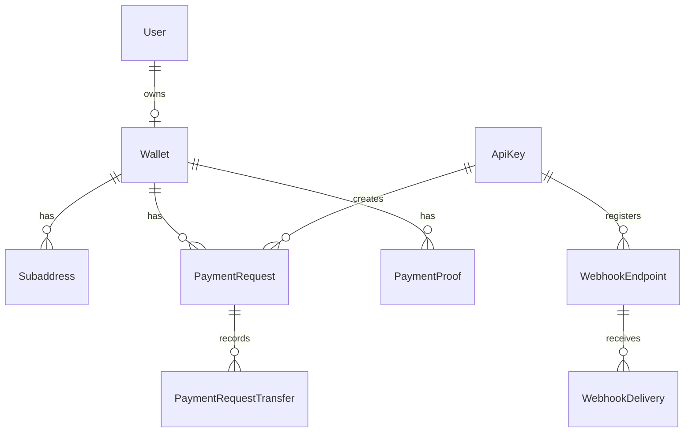

# Data model

PostgreSQL is the source of truth. The Prisma schema defines ten models; this page describes their fields and relationships. You can read the full definition in [`prisma/schema.prisma`](https://github.com/ribaunt/pay/blob/main/prisma/schema.prisma).

## User

The single local account created on first login from the `.env` credentials.

| Field | Type | Notes |
| --- | --- | --- |
| `id` | String, PK | `single-user`. |
| `email`, `name` | String? | From configuration. |
| `passwordHash` | String | Default empty; credentials live in `.env`. |
| `sessionVersion` | Int | Incremented on logout to invalidate old cookies. |
| `isAnonymous` | Boolean | Always `false` in current operation. |

## ApiKey

| Field | Type | Notes |
| --- | --- | --- |
| `id` | String, PK | CUID. |
| `name` | String | Human label, up to 80 characters. |
| `keyHash` | String, unique | SHA-256 of the plaintext key. |
| `prefix` | String | First characters, for display only. |
| `scopes` | String | Comma-separated, or `*`. |
| `createdAt`, `expiresAt`, `revokedAt`, `lastUsedAt` | DateTime? | Lifecycle timestamps. |
| `links`, `webhooks` | relations | Requests and endpoints created with this key. |

## Wallet

| Field | Type | Notes |
| --- | --- | --- |
| `id` | String, PK | CUID. |
| `name` | String, unique | Wallet filename. |
| `walletFile` | String | File on the `wallet_data` volume. |
| `address` | String | Primary address. |
| `viewKey` | String? | AES-256-GCM encrypted; never returned by an API. |
| `restoreHeight` | Int? | Scan start height. |
| `isWatchOnly` | Boolean | Always `true` for wallets created here. |
| `description` | String? | Optional label. |
| `userId` | String, unique | Owning user. |

## Subaddress

| Field | Type | Notes |
| --- | --- | --- |
| `id` | String, PK | CUID. |
| `walletId` | String | Owning wallet. |
| `address` | String | The generated subaddress. |
| `addressIndex` | Int | Unique per wallet. |
| `label` | String? | Optional label. |
| `used`, `lastUsedAt` | Boolean / DateTime? | Updated by settlement. |

## PaymentRequest

The central record. A fiat link stores the locked quote alongside the amount.

| Field | Type | Notes |
| --- | --- | --- |
| `id` | String, PK | Public link ID. |
| `walletId` | String | Owning wallet. |
| `address`, `amount`, `uri` | String | Subaddress, piconero amount as a string, payment URI. |
| `label` | String? | Up to 200 characters. |
| `status` | String | `pending` by default; see [lifecycle](payment-lifecycle.md). |
| `expiresAt`, `paidAt`, `cancelledAt`, `lateDetectedAt` | DateTime? | Milestones. |
| `txHash` | String? | Transaction hash once seen. |
| `confirmations` | Int | Current count. |
| `publicTokenHash` | String, unique | SHA-256 of the status token. |
| `fiatAmount`, `fiatCurrency` | String? | Original fiat values. |
| `rateUsd`, `fxRate`, `rateSources` | String? | Locked quote. |
| `rateFetchedAt` | DateTime? | Quote timestamp. |
| `rateStale`, `rateDegraded` | Boolean | Quote quality flags. |
| `apiKeyId` | String? | Creating key. |
| `idempotencyKeyHash`, `requestHash`, `responseSnapshot` | String? | Retry handling. |
| `idempotencyExpiresAt` | DateTime? | Usually 24 hours after creation. |
| `requiredConfirmations` | Int? | Per-link override, 1–100. |
| `receivedAtomic` | String? | Total received in piconero. |
| `renewedFromId` | String? | Previous link when renewed. |

Indexes cover `(walletId, status)` and `(status, expiresAt)`, which are the settlement hot paths.

## PaymentRequestTransfer

One row per transaction observed for a link.

| Field | Type | Notes |
| --- | --- | --- |
| `id` | String, PK | CUID. |
| `paymentRequestId` | String | Owning request. |
| `txid` | String | Unique per request. |
| `amount` | String | Piconero as a string. |
| `blockHeight` | Int | Block containing the transfer. |

## PaymentProof

| Field | Type | Notes |
| --- | --- | --- |
| `id` | String, PK | CUID. |
| `walletId` | String | Wallet that generated it. |
| `txHash`, `address`, `message` | String | Unique together with `walletId`. |
| `signature` | String | Proof signature. |

## WebhookEndpoint

| Field | Type | Notes |
| --- | --- | --- |
| `id` | String, PK | CUID. |
| `url` | String | Validated public HTTPS URL. |
| `secret` | String | Encrypted `whsec_...` value. |
| `events` | String | Comma-separated event names or `*`. |
| `enabled` | Boolean | `true` by default. |
| `apiKeyId` | String? | Key that registered it. |

## WebhookDelivery

| Field | Type | Notes |
| --- | --- | --- |
| `id` | String, PK | Used in `x-pay-delivery-id` and the signature. |
| `endpointId` | String | Target endpoint. |
| `event`, `payload` | String | Event name and raw JSON body. |
| `status` | String | `pending`, `delivered`, `dead`, or `failed`. |
| `attempts`, `nextRetryAt`, `lastStatus`, `error` | Int / DateTime? / Int? / String? | Retry state. |
| `createdAt`, `deliveredAt` | DateTime | Timestamps. |

An index on `(status, nextRetryAt)` supports the dispatch query.

## RateLimitBucket

| Field | Type | Notes |
| --- | --- | --- |
| `key` | String, PK | For example `payment-link:<apiKeyId>`. |
| `count` | Int | Requests in the current window. |
| `resetAt` | DateTime | Window expiry. |

Storing buckets in PostgreSQL makes limits consistent across app replicas and restarts. No client IP is stored for API-key calls.

## Amounts in the database

All XMR amounts are strings containing integer piconero, not floating-point numbers. 1 XMR equals `1_000_000_000_000` piconero. Conversion helpers in `src/lib/monero/money.ts` guard the safe-integer range before handing values to JSON-RPC.
