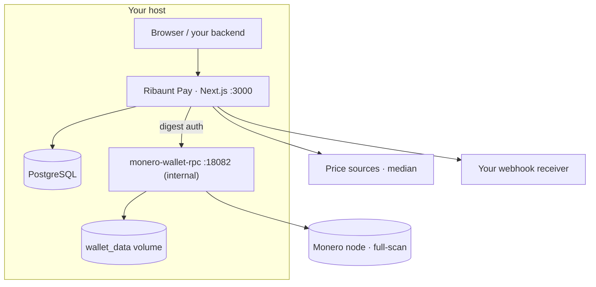

# How it works

Ribaunt Pay is a small number of processes with clear boundaries. The app knows about payments and customers; the wallet RPC knows about Monero; PostgreSQL holds state; an external node holds the chain.



## The pieces

### Next.js app

Serves the two small UI pages and every `/api/*` route. Route handlers are thin: they authenticate, apply a rate limit, and call a function in `src/lib`. The app is built as a standalone output and runs as a non-root user.

### PostgreSQL

The source of truth for payment requests, API keys, webhook endpoints and deliveries, proofs, subaddress metadata, and rate-limit buckets. Migrations run on container startup with `prisma migrate deploy`.

### `monero-wallet-rpc`

A single wallet can be open at a time. The app serializes `open_wallet` / `close_wallet` calls and keeps track of the loaded file. It uses HTTP Digest authentication with credentials from `.env` and is never exposed on a host port in production.

### Monero node

You provide the node. The stack does not bundle `monerod`. In production the app requires `MONERO_DAEMON_MODE=full-scan`, which keeps view-key scanning local instead of sending the view key to a remote daemon. A SOCKS proxy can route that traffic.

### Price sources

Fiat links are quoted from CoinGecko, CoinCap, Coinbase, and Kraken for XMR/USD, plus Frankfurter or exchangerate.host for currency conversion. Results are aggregated by median with outlier filtering. The rate is stored on the payment request when it is created.

## Two kinds of caller

| Caller | How it authenticates | Typical use |
| --- | --- | --- |
| Browser session | Signed cookie `pay_session` | Setup, wallet reads, key management. |
| Server-to-server | `x-api-key` with scopes | Creating links, listing, webhooks, audit, metrics. |
| Scheduler | `x-cron-secret` | Settlement and webhook dispatch only. |
| Anonymous | Status token in a header, or nothing at all | Payment status and proof verification. |

There is no sign-up or anonymous-session endpoint. The only account is the one configured in `.env`.

## What is automatic and what is not

Creating a link writes state and generates an address immediately. Everything that follows — detecting a transfer, advancing confirmations, expiring a link, emitting and delivering webhooks — is driven by cron endpoints:

```text
POST /api/cron/payment-links   → settlement pass
POST /api/cron/webhooks        → delivery pass
```

Both require `x-cron-secret`. A missed cron means stuck payment states, not lost funds — the next pass catches up.

## Read next

- [Payment lifecycle](payment-lifecycle.md) — states, settlement math, and event timing.
- [Privacy model](privacy-model.md) — what is stored, what is never sent, and why.
- [Data model](data-model.md) — every Prisma model and its important fields.
- [API overview](../api/index.md) — endpoints grouped by audience.
