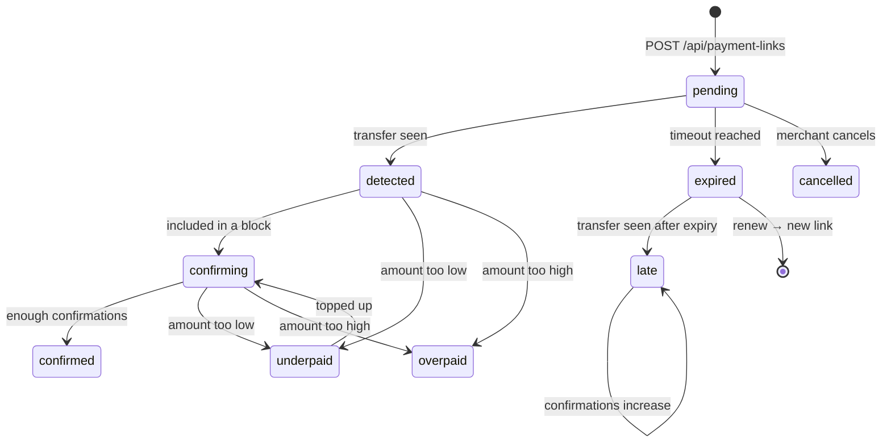

# Payment lifecycle

A payment link moves through a small set of states. Understanding when each transition happens makes it easier to design polling and webhook handling.

## Creation

1. The app looks up the single wallet. If none is configured, creation fails with a clear error.
2. It validates the amount. Fiat amounts go through the oracle and fixed-point conversion; XMR amounts are parsed into piconero with up to 12 decimals.
3. A reservation row is written with status `processing`, a hashed status token, and the optional idempotency key hash.
4. The wallet RPC generates a fresh subaddress and a `monero:` URI for the amount.
5. The reservation becomes `pending`, the response snapshot is saved, and `payment.created` is queued.

If any step after reservation fails, the reservation is deleted so it can't block a retry.

## Settlement

`POST /api/cron/payment-links` processes up to 200 active links at a time. For each link it:

1. Fetches incoming and pool transfers from the wallet.
2. Picks transfers whose `txid` matches the stored hash or whose address matches the link's subaddress, deduplicated by transaction ID.
3. Records each transfer in `PaymentRequestTransfer`.
4. Sums the received amounts in piconero and compares them with the requested amount.
5. Computes confirmations as `walletHeight - highestBlockHeight + 1`.
6. Applies the state rules below and writes `txHash`, `paidAt`, `confirmations`, and `receivedAtomic`.
7. Marks the subaddress as used and queues an event if the status changed.

### State rules

The checks run in this order:

| Condition | Resulting status |
| --- | --- |
| Link was already `expired` or `late` | `late` |
| Received less than requested | `underpaid` |
| Received more than requested, confirmations still below target | `overpaid` |
| Confirmations at or above the target | `confirmed` |
| Confirmations above zero | `confirming` |
| Otherwise | `detected` |

Additional transfers to the same subaddress top up an underpaid link. Overpayments are recorded in `receivedAtomic` and never trigger an automatic refund. A late payment keeps updating its confirmation count, but it never gets auto-refunded either. It stays there for manual review through `GET /api/payment-links?status=late`.

## Confirmations

The default is `PAYMENT_REQUIRED_CONFIRMATIONS` (10). A link can override it with `requiredConfirmations` between 1 and 100. The status response reports both `confirmations` and `confirmationsRemaining`, which is the target minus the current count, floored at zero.

## Expiry

`timeoutSeconds` is clamped between `PAYMENT_MIN_TIMEOUT_SECONDS` and `PAYMENT_MAX_TIMEOUT_SECONDS`. A value of `0` means no expiry. When a `pending` link passes its expiry with no transaction, settlement marks it `expired` and queues `payment.expired`.

Renewal is only allowed for an `expired` link with no transaction. It creates a fresh link with a new subaddress, token, expiry, and (for fiat links) a new quote.

## Events

Events are emitted on actual status transitions, not on every pass. A link moving from `detected` to `confirming` emits once; further confirmations don't emit until the status changes again. Each event is queued as a `WebhookDelivery` row, and `POST /api/cron/webhooks` does the actual HTTP delivery.

!!! tip "Handle events idempotently"
    Deliveries are retried on failure, so the same event can arrive more than once. Use `x-pay-delivery-id` to deduplicate, and treat status as something that moves forward, not a one-time signal.

## Failure modes

| Problem | Effect | Recovery |
| --- | --- | --- |
| Cron job stops | Links stay in their current state | Restart the cron job; the next pass catches up. |
| Wallet RPC unreachable | Settlement returns an upstream error (`502`) | Fix the RPC; no status is written. |
| Wallet behind the daemon | Confirmations undercount | Watch `pay_wallet_sync_lag_blocks`. |
| Webhook receiver down | Deliveries retry with backoff, then become `dead` | Inspect the delivery rows and replay. |
| Price sources down | Fiat link creation fails unless a recent cached quote can be served stale | See `stale` and `degraded` in quote responses. |
