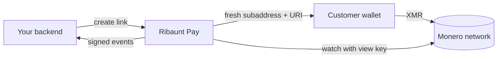

# Receive payments, without the surveillance!

**Ribaunt Pay** is a small, self-hosted server for accepting Monero. You give it a watch-only wallet, it generates a fresh address for every payment, watches the chain, and tells your application when a payment is confirmed. It has no sign-ups, no analytics, and no spend keys.

It runs as a Docker Compose stack: a Next.js app, PostgreSQL, and `monero-wallet-rpc`. You point it at a Monero node you trust. No `monerod` is bundled.

-   :lucide-rocket:{ .lg .middle } __Get running__

    ---

    Set up a stack, add your view key, and create your first payment link in a few minutes.

    [Quickstart](getting-started/quickstart.md)

-   :lucide-credit-card:{ .lg .middle } __Accept payments__

    ---

    Fiat or XMR amounts, expiring links, status polling by token, and signed webhooks.

    [Payment links](guides/payment-links.md)

-   :lucide-braces:{ .lg .middle } __Integrate__

    ---

    A JSON API for links, wallets, prices, proofs, keys, and metrics, with typed responses.

    [API reference](api/index.md)

## How a payment works

1. Your backend creates a link with an amount and an optional expiry.
2. Ribaunt Pay generates a fresh subaddress and locks in the exchange rate if the price is fiat.
3. The customer sends XMR to that address. There's no account or checkout session to create.
4. A scheduled job detects the transfer, tracks confirmations, and emits webhooks as the status changes.
5. Your app checks the status with a secret token, or listens for `payment.confirmed`.

[Read the full walkthrough](architecture/payment-lifecycle.md){ .md-button .md-button--primary }
[Browse the guides](guides/index.md){ .md-button }

## What you get

| | |
| --- | --- |
| **Watch-only by design** | Spend keys are never requested, sent, or stored. Only the private view key is used, and it is encrypted before it reaches PostgreSQL. |
| **Fresh address per link** | Incoming payments cannot be linked to one another by address. Used subaddresses are detected and tracked. |
| **Fiat or XMR pricing** | Fiat quotes come from a median of several price sources, with a rate locked onto each payment request. Conversion uses fixed-point math. |
| **No weak defaults** | Production secrets are length-checked at startup. The RPC service has no host port and uses HTTP Digest auth. |
| **Your network, your node** | Clearnet, Tor onion, I2P, or no clearnet ports at all. Route daemon traffic through a SOCKS proxy if you want. |
| **Observable** | A health endpoint and Prometheus metrics, with a ready-made alert rules file. |

## Where to go next

- [Install and configure](getting-started/installation.md): prerequisites, `.env`, and Compose profiles.
- [Set up a wallet](guides/watch-only-wallet.md): what a view key can and can't do.
- [Read the API overview](api/index.md): authentication, rate limits, and error format.
- [Explore the data model](architecture/data-model.md): the types behind the endpoints.
- [License](https://github.com/ribaunt/pay/blob/main/LICENSE): Apache License 2.0.

!!! note "This site is for version 0.1.x"
    The API and configuration reference describe the code in [`ribaunt/pay`](https://github.com/ribaunt/pay). If you are running a different revision, check the repository for changes.
